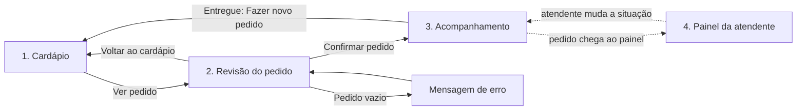

# Fluxo de navegação

Seta cheia: toque do aluno. Seta tracejada: atualização automática entre aluno e atendente.

| Tela | Ação | Resultado |
| --- | --- | --- |
| Cardápio | `+` / `−` | Muda a quantidade, até 5 unidades por item, e atualiza a contagem em "Ver pedido" |
| Cardápio | Ver pedido | Abre a Revisão do pedido |
| Revisão | `+` / `−` | Muda a quantidade, até 5 unidades por item, e recalcula o total |
| Revisão | Remover | Tira o item e recalcula o total |
| Revisão | Voltar ao cardápio | Volta sem perder os itens |
| Revisão | Confirmar pedido | Abre o Acompanhamento e envia o pedido ao painel |
| Painel | Em preparo / Pronto / Entregue | Muda a situação no painel e no Acompanhamento |
| Painel | Marcar item esgotado | Abre a lista de itens; um toque alterna a disponibilidade no cardápio e tira do pedido em aberto o item esgotado |
| Acompanhamento | Fazer novo pedido | Volta ao Cardápio; só aparece após "Entregue" |

## Estados alternativos

1. **Erro, pedido vazio:** ao confirmar sem itens, aparece "Adicione pelo menos um item antes de confirmar." e a tela não avança.
2. **Erro, limite de quantidade:** ao passar de 5 unidades do mesmo item, aparece "Limite de 5 unidades por item." e a quantidade não muda.
3. **Aviso, item esgotado:** se a atendente esgotar um item que está no pedido, ele é removido e o aluno recebe um aviso.
4. **Sucesso:** o Acompanhamento mostra "Pedido confirmado", o número do pedido e o próximo passo.

## Limite do protótipo

Não há backend. Aluno e atendente compartilham o estado na mesma aba, e recarregar a página reinicia os dados. Os nomes são fictícios.
